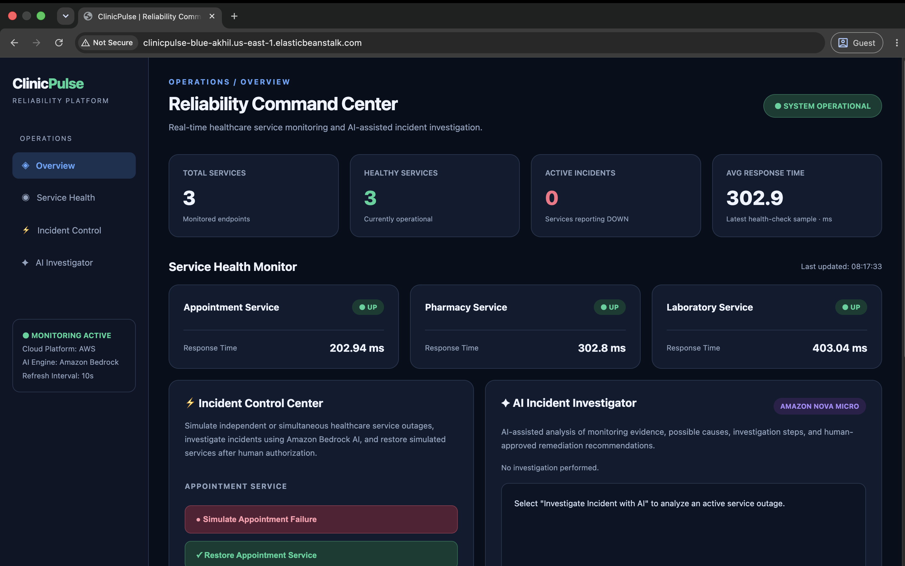
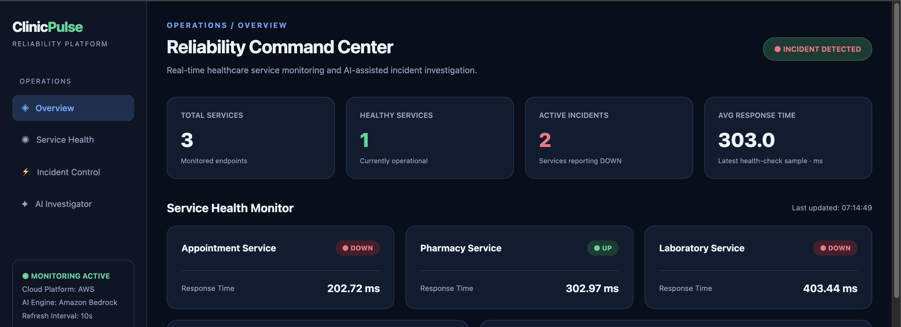
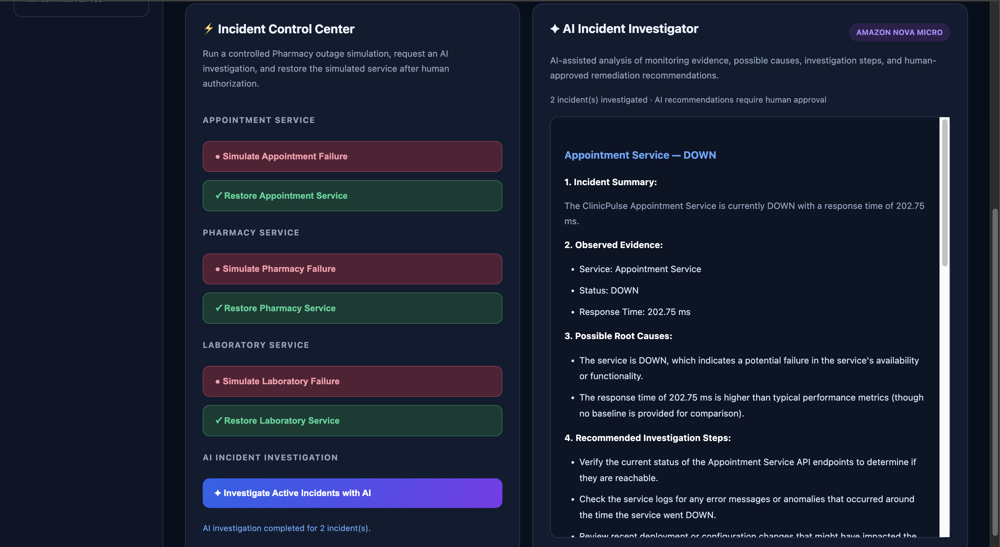
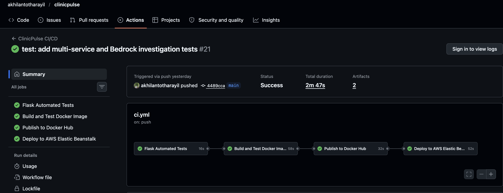

# 🏥 ClinicPulse
### AI-Powered Healthcare Reliability & Incident Monitoring

ClinicPulse is a cloud-based monitoring and incident simulation platform developed for the **#BuildOnElasticBeanstalk Hackathon**, organized by TrainWithShubham.

The project demonstrates how DevOps practices, AWS cloud services, and generative AI can support incident detection, investigation, and recovery.

## 🚀 Features

- **Healthcare Service Monitoring:** Monitor Appointment, Pharmacy, and Laboratory services.
- **Live Dashboard:** View service health, response times, and active incident counts.
- **Failure Simulation:** Simulate individual or simultaneous service outages.
- **AI Incident Investigation:** Generate troubleshooting recommendations using Amazon Bedrock Nova Micro.
- **Human-Authorized Recovery:** Restore simulated services after reviewing investigation results.
- **Automated CI/CD:** Test, build, scan, and deploy through GitHub Actions.
- **AWS Monitoring:** Integrate Amazon CloudWatch metrics, alarms, and Amazon SNS notifications.

## 📸 ClinicPulse Screenshots

### 🟢 Live Healthcare Monitoring Dashboard

Monitor Appointment, Pharmacy, and Laboratory service health in real time.

### 🔴 Incident Simulation

Simulate service outages and observe how ClinicPulse displays unhealthy services.

### 🤖 AI-Assisted Incident Investigation

Amazon Bedrock Nova Micro analyzes service status and response-time information to suggest possible causes and troubleshooting steps.

### ⚙️ Automated DevOps CI/CD Pipeline

GitHub Actions automates testing, Docker builds, security scanning, image publishing, and AWS Elastic Beanstalk deployment.

## 🛠️ Technology Stack

| Component | Technology |
|---|---|
| Backend | Python, Flask |
| Web Server | Gunicorn |
| Frontend | HTML, CSS, JavaScript |
| Containerization | Docker |
| CI/CD | GitHub Actions |
| Security Scanning | Trivy |
| Container Registry | Docker Hub |
| Cloud Deployment | AWS Elastic Beanstalk |
| Monitoring | Amazon CloudWatch |
| Notifications | Amazon SNS |
| Generative AI | Amazon Bedrock (Nova Micro) |

## 🌐 Live Dashboard

http://clinicpulse-blue-akhil.us-east-1.elasticbeanstalk.com

**Security note:** The public dashboard currently uses HTTP. Incident simulation and AI investigation controls require an authorization token and should only be used through a secure connection.

## 🔄 Incident Management Workflow

1. Monitor healthcare service availability.
2. Detect a simulated service outage.
3. Display the incident on the dashboard.
4. Request an AI-assisted investigation.
5. Review possible causes and troubleshooting recommendations.
6. Restore the simulated service with human authorization.
7. Verify that the service returns to a healthy state.

## ⚠️ Project Scope

ClinicPulse is an educational DevOps/SRE demonstration.

The healthcare services are simulated Flask endpoints rather than independently deployed microservices.

AI-generated recommendations are investigative suggestions, not confirmed root causes.

Simulation recovery does not restart production infrastructure.

## 👨‍💻 Author

**Akhil Anto Tharayil**

Built for the #BuildOnElasticBeanstalk Hackathon.

Special thanks to **Shubham Londhe** and **TrainWithShubham** for organizing this learning opportunity.

## 🏗️ System Architecture

ClinicPulse uses GitHub Actions for CI/CD, Docker for containerization, and AWS Elastic Beanstalk for deployment.

The application integrates Amazon CloudWatch for monitoring, Amazon SNS for notifications, and Amazon Bedrock Nova Micro for AI-assisted incident investigation.

📐 **[View the Complete AWS Architecture Diagram](docs/architecture.md)**

## 🚀 Deployment Guides

Want to deploy ClinicPulse yourself?

Follow these beginner-friendly guides:

- 🐳 [Local Deployment Using Docker](docs/local-deployment.md)
- ☁️ [AWS Elastic Beanstalk Deployment — Manual & CI/CD](docs/aws-deployment.md)

The guides explain how to deploy ClinicPulse using your own environment and AWS account.
