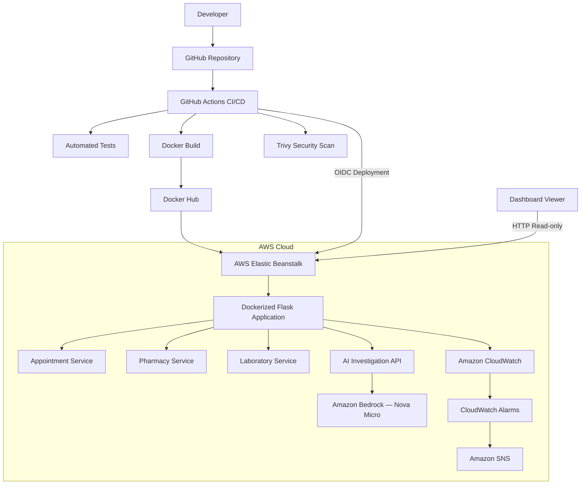

# ClinicPulse — AWS Architecture

## Architecture Notes

- GitHub Actions automates testing, image creation, security scanning, publishing, and deployment.
- Docker Hub stores the application container image.
- Elastic Beanstalk runs the Dockerized Flask application.
- Appointment, Pharmacy, and Laboratory are simulated endpoints within the Flask application.
- Amazon Bedrock Nova Micro generates AI-assisted incident investigation reports.
- Amazon CloudWatch collects monitoring metrics.
- CloudWatch alarms can trigger Amazon SNS notifications.
- The public HTTP dashboard is intended for read-only viewing until HTTPS is configured.
